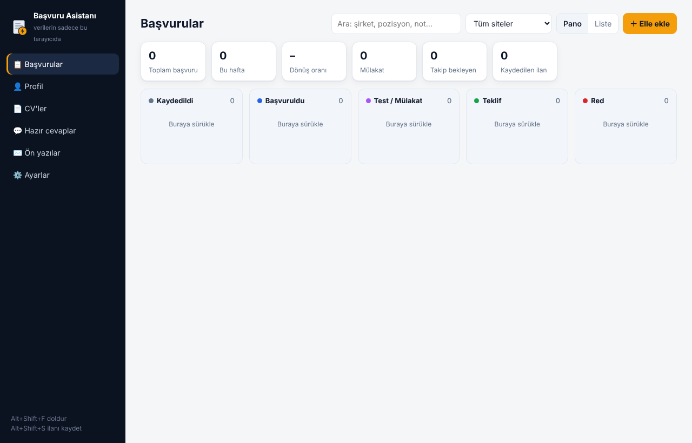
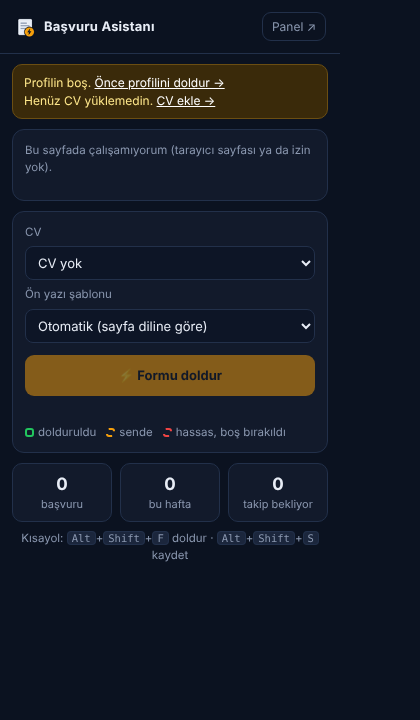

> **English:** A Chrome extension (Manifest V3) that fills the standard fields of job and internship application forms, attaches your CV and tracks your applications on a Kanban board with follow-up reminders. It **never submits a form by itself**, skips sensitive questions (ID number, IBAN, passwords, demographic questions) and keeps all data only in your browser.
>
> Works on LinkedIn, Kariyer.net, Youthall, Greenhouse, Lever, Workday, SmartRecruiters, Indeed and more.

| Applications board | Popup |
|---|---|
|  |  |

---

# Başvuru Asistanı (Chrome eklentisi)

İş ve staj başvurularında formdaki standart alanları doldurur, CV'ni dosya alanına ekler ve başvurularını takip eder. Sunucu yok; tüm veriler yalnızca senin tarayıcında (`chrome.storage.local`) durur.

## Kurulum
1. Zip'i bir klasöre çıkar.
2. Chrome'da `chrome://extensions` aç, sağ üstten **Geliştirici modu**nu aç.
3. **Paketlenmemiş öğe yükle** → `basvuru-asistani` klasörünü seç.
4. Açılan panelde **Profil**'i doldur, **CV'ler**'den PDF'ini yükle.

## Kullanım
- **⚡ Doldur**: İlan veya başvuru sayfasında sağ alttaki butona, eklenti simgesine ya da `Alt+Shift+F`'ye bas.
  - Yeşil çerçeve: dolduruldu. Turuncu: senin doldurman gereken alan. Kırmızı: hassas alan (TC kimlik, şifre vb.), bilerek boş bırakıldı.
- **Hatırla**: Şirkete özel bir soruyu elle cevaplayınca eklenti “Hatırlayayım mı?” diye sorar. Benzer soru bir dahaki sefere otomatik dolar.
- **Ön yazı**: “Ön yazı / Cover letter” alanına seçili şablon, ilan sayfasından alınan şirket ve pozisyon adıyla yazılır.
- **Takip**: `＋ Takip`, `Alt+Shift+S` ya da sağ tık menüsü ilanı panoya ekler. “Başvur / Submit”e basınca eklenti “Başvurdun mu?” diye sorar.
- **Hatırlatma**: Başvurudan N gün sonra (varsayılan 7) bildirim gelir, simgede sayaç çıkar. Panelde tek tıkla takip e-postası taslağı kopyalanır.
- **Panel**: Kanban pano (sürükle-bırak), liste görünümü, istatistikler, ilan metninin yedeği, JSON yedek, CSV (Excel) dışa aktarım.

## Nerede çalışır?
Kendiliğinden: LinkedIn, Kariyer.net, Youthall, Toptalent, Anbean, Greenhouse, Lever, Workday, SuccessFactors, SmartRecruiters, SecretCV, Yenibiris, Indeed, Glassdoor.
Başka bir sitede: eklenti simgesine bas ve **Formu doldur** de. Ya da Ayarlar → **Tüm sitelerde çalış** iznini ver.

## Bilerek yapmadıklarımız
- Formu **asla kendisi göndermez**, “İleri / Gönder”e basmaz. LinkedIn kurallarına uygun kalmak için toplu başvuru ya da otomatik gezinme de yok.
- Cinsiyet, engellilik, din, medeni durum, adli sicil, çalışma izni gibi sorulara dokunmaz.
- KVKK / onay kutularını işaretlemez.
- TC kimlik no, IBAN, şifre gibi bilgileri saklamaz.

## Dosya yapısı
```
manifest.json        MV3 tanımı, izinler, kısayollar
src/core.js          Alan sözlüğü (TR+EN), normalizasyon, depolama, takip yardımcıları
src/content.js       Alan tespiti + puanlama, React uyumlu doldurma, CV ekleme, ilan yakalama, yüzen buton
src/background.js    Sağ tık menüsü, kısayollar, hatırlatma alarmı, rozet
popup/               Simgeye basınca açılan küçük pencere
panel/               Tam panel (başvurular, profil, CV, cevaplar, şablonlar, ayarlar)
```

## Geliştirmek istersen
- Yeni alan eklemek için `src/core.js` içindeki `FIELDS` listesine bir satır ekle (`key`, `label`, `group`, `re`). Panel formu otomatik oluşur.
- Bir sitede alan yanlış eşleşirse önce o alanın `re` / `not` ifadesine bak.
- Site değişince ilan başlığı gelmezse `content.js` → `siteSpecific()` içindeki seçicileri güncelle.
- Workday'in özel açılır menüleri ve tarih seçicileri her zaman dolmayabilir. Bunlar turuncu işaretlenir.
